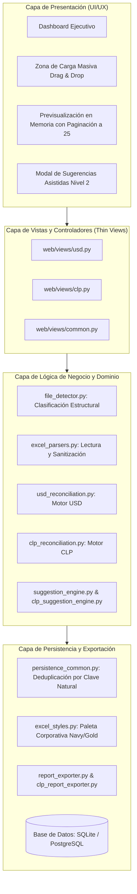

# Sistema de Conciliación Financiera ERP — Hotel Plaza San Francisco (v2.0)

[](https://hotelsanfrancisco.pythonanywhere.com/)
[](https://www.djangoproject.com/)
[](https://www.python.org/)
[](https://getbootstrap.com/)

Plataforma web corporativa de alta precisión diseñada para automatizar, auditar y persistir el proceso de conciliación bancaria y cuadratura de tarjetas de crédito y débito del **Hotel Plaza San Francisco (HPSF)**.

El sistema procesa y cruza masivamente la información transaccional proveniente del sistema hotelero (**FrontOffice ERP**), las liquidaciones de **Transbank**, las **cartolas bancarias** (Banco de Chile y BancoEstado) y los reportes de franquicias internacionales (*Visa, MasterCard, American Express y Diners Club*), resolviendo automáticamente ventas en cuotas, desfases de turnos y errores tipográficos.

> 🌐 **Entorno de Producción Activo:** [https://hotelsanfrancisco.pythonanywhere.com/](https://hotelsanfrancisco.pythonanywhere.com/)

---

## 📌 Tabla de Contenidos
1. [Descripción General y Dominio de Negocio](#-descripción-general-y-dominio-de-negocio)
2. [Arquitectura del Sistema y Principios de Diseño](#-arquitectura-del-sistema-y-principios-de-diseño)
3. [Tecnologías Utilizadas](#-tecnologías-utilizadas)
4. [Módulos y Funcionalidades Implementadas](#-módulos-y-funcionalidades-implementadas)
   * [Fase 1: Módulo Dólares (USD - Tarjetas Internacionales)](#fase-1-módulo-dólares-usd---tarjetas-internacionales)
   * [Fase 2: Módulo Pesos (CLP - Tarjetas Nacionales)](#fase-2-módulo-pesos-clp---tarjetas-nacionales)
   * [Motor de Sugerencias Asistidas (Nivel 2)](#motor-de-sugerencias-asistidas-nivel-2)
   * [Panel de Control Ejecutivo (Dashboard)](#panel-de-control-ejecutivo-dashboard)
   * [Exportación de Reportes Oficiales en Excel](#exportación-de-reportes-oficiales-en-excel)
5. [Seguridad y Protección del Sistema](#-seguridad-y-protección-del-sistema)
6. [Instrucciones de Instalación y Ejecución Local](#-instrucciones-de-instalación-y-ejecución-local)
7. [Configuración y Despliegue en Producción](#-configuración-y-despliegue-en-producción)

---

## 🏢 Descripción General y Dominio de Negocio

El Hotel Plaza San Francisco gestiona diariamente cientos de transacciones tanto de huéspedes extranjeros como nacionales. Tradicionalmente, la cuadratura contable demandaba largas horas de digitación manual en hojas de cálculo, con riesgos de diferencias por redondeo, comisiones bancarias no conciliadas y desfases de fechas por turnos de recepción.

La plataforma v2.0 sustituye por completo el proceso manual y corrige las fallas críticas del sistema heredado (v1.0), proporcionando:
* **Cuadratura Matemática Exacta:** Cálculo de comisiones, retenciones de IVA, ventas brutas, cuotas y abonos netos en cuenta corriente.
* **Ciclo Estricto en Memoria (*Zero-Write Preview*):** Toda la lectura, normalización y análisis ocurre en memoria RAM dentro de la sesión de Django; nada se escribe en la base de datos hasta que el auditor revisa la previsualización y confirma explícitamente el cierre.
* **Trazabilidad y Auditoría Inmutable:** Registro histórico de cierres con bitácoras de auditoría (`AuditResolutionLog`) para cada excepción resuelta.

---

## 🏛 Arquitectura del Sistema y Principios de Diseño

El sistema está estructurado bajo principios de **Clean Architecture**, **Alta Cohesión** y **Separación Estricta de Responsabilidades (SRP / DRY)**:



1. **Capa de Lectura y Detección (`file_detector.py`, `excel_parsers.py`):** Desacopla la manipulación de DataFrames y el manejo de celdas combinadas de la lógica contable. Detecta automáticamente roles por contenido sin depender del nombre del archivo.
2. **Capa de Conciliación de Dominio (`usd_reconciliation.py`, `clp_reconciliation.py`):** Aplica las reglas contables puras, matching por tuplas, resolución de facturas divididas y balanceo de depósitos bancarios.
3. **Capa de Persistencia Común (`persistence_common.py`):** Centraliza la deduplicación atómica mediante claves naturales compuestas y transacciones seguras (`transaction.atomic()`).
4. **Capa de Estilos y Reportes Corporativos (`excel_styles.py`, `report_exporter.py`, `clp_report_exporter.py`):** Genera exportables oficiales en formato Excel (`.xlsx`) multi-hoja bajo el libro de marca del hotel.

---

## 🛠 Tecnologías Utilizadas

### Backend & Procesamiento de Datos
* **[Python 3.12+](https://www.python.org/):** Lenguaje base del proyecto.
* **[Django 5.1+ / 6.1+](https://www.djangoproject.com/):** Framework web robusto con ORM relacional y motor de plantillas.
* **[Pandas 3.0+](https://pandas.pydata.org/):** Ingesta, saneamiento y manipulación masiva de datos en memoria.
* **[OpenPyXL 3.1+](https://openpyxl.readthedocs.io/):** Generación de libros Excel multi-hoja de alta fidelidad estética y fórmulas contables.
* **[xlrd 2.0+](https://xlrd.readthedocs.io/):** Soporte de lectura de archivos heredados con formato Excel 97-2003 (`.xls`).
* **[SQLite 3](https://www.sqlite.org/) / [PostgreSQL](https://www.postgresql.org/):** Motor de persistencia relacional con transacciones ACID.

### Frontend & Interfaz de Usuario
* **[Bootstrap 5.3](https://getbootstrap.com/):** Componentes responsive, modales, alertas y diseño de grillas.
* **[Bootstrap Icons 1.11](https://icons.getbootstrap.com/):** Iconografía corporativa.
* **JavaScript ES6+ Nativo:** Drag & Drop, consumo de endpoints AJAX, filtros y paginación en memoria sin dependencias externas pesadas.
* **CSS3 Custom Variables (`theme.css`):** Paleta institucional de HPSF (Navy `#0C0C42`, Gold `#996909`), compatible con Modo Claro y Modo Oscuro persistente.

### Seguridad & Infraestructura
* **[django-axes 8.3+](https://django-axes.readthedocs.io/):** Detección y bloqueo automático contra ataques de fuerza bruta por IP y usuario.
* **[PythonAnywhere](https://www.pythonanywhere.com/):** Infraestructura en la nube con soporte WSGI, HTTPS/SSL y cabeceras de proxy seguro.

---

## 🚀 Módulos y Funcionalidades Implementadas

### Fase 1: Módulo Dólares (USD - Tarjetas Internacionales)
* **Ingesta Multi-Archivo (7 Insumos):** FrontOffice ERP del hotel, Abono Transbank Divisas, Cartola Bancaria en USD (Banco de Chile) y 4 operadores de franquicias internacionales (*Visa, MasterCard, American Express y Diners Club*).
* **Cruce Triple en Cascada:**
  1. Transbank POS vs. ERP Hotel (con soporte de *Split Invoices* / facturas divididas).
  2. ERP Hotel vs. Liquidación de la Operadora en USD y verificación de conversión cambiaria en pesos (`SALDO` vs `SALDO CORREGIDO`).
  3. Validación del depósito neto esperado contra los abonos reales de la cartola en dólares.

### Fase 2: Módulo Pesos (CLP - Tarjetas Nacionales)
* **Ingesta Flexible y Unificada:**
  * **Borderó ERP:** Soporta múltiples archivos correspondientes a distintos turnos de recepción, excluyendo cargos en divisa extranjera y deduplicando tuplas naturales.
  * **Abonos Transbank CLP (Categoría Unificada):** Soporta tanto la carga de **1 único archivo consolidado** (*"Todos los medios de pago"*) como la de **2 a 3 archivos individuales** separados por modalidad (*Crédito*, *Débito* y *Prepago*).
  * **Cartola Bancaria Multibanco:** Admite cartolas de **Banco de Chile** y cartolas históricas de **BancoEstado** (lectura automática de la hoja `'Movimientos'` y extracción de folios de operación).
* **Gestión de Ventas en Cuotas:**  
  Distingue con precisión matemática el *Monto Original de Compra* frente al *Monto Válido para Abono* en compras en cuotas (ej. cuota `3/3`), evitando descuadres artificiales frente a la cartola bancaria.
* **Tratamiento de Excepciones Contables:**
  * `CARD_TYPE_MISMATCH`: Detección de ventas digitadas en el ERP con un medio de pago erróneo (ej. tarjeta de crédito digitada como Redcompra débito).
  * `OUT_OF_PERIOD`: Clasificación aislada de cuotas plurimensuales anteriores o ventas desfasadas por turnos nocturnos de recepción.

### Motor de Sugerencias Asistidas (Nivel 2)
* Diagnóstico consultivo que cruza vouchers huérfanos y discrepancias contra registros no reclamados del ERP o de la **base de datos histórica**.
* Algoritmo de similitud de caracteres tipográficos / OCR (`O↔0`, `I↔1`, `8↔6`, ceros a la izquierda) y detección de diferencias por propinas omitidas.
* Consulta SQL pre-cargada optimizada (prevención de cuellos de botella $N+1$).
* Modales interactivos con texto de advertencia formal y visualización lado a lado.

### Panel de Control Ejecutivo (Dashboard)
* Alternancia fluida entre paneles **Dólares (USD)** y **Pesos (CLP)** con un clic.
* Métricas en tiempo real: tasa de conciliación porcentual, monto total auditado, resumen de excepciones pendientes y tabla de los últimos cierres guardados.
* Acciones rápidas en el encabezado: *"Nueva conciliación"* y *"Reporte del último cierre"* sincronizadas dinámicamente con la moneda activa.

### Exportación de Reportes Oficiales en Excel
* Generación bajo demanda de libros `.xlsx` estilizados con cabeceras corporativas, formato numérico chileno (`$ #.##0` / `US$ #.##0,00`), alerta roja para discrepancias y autoajuste inteligente de columnas.
* Estructura multi-hoja: Resumen Ejecutivo, Vouchers Conciliados y Detalle de Excepciones con glosa del auditor.

---

## 🔒 Seguridad y Protección del Sistema

* **Protección contra Fuerza Bruta (`django-axes`):** Bloqueo automático temporal tras 5 intentos fallidos consecutivos de inicio de sesión por combinación *Usuario + IP*.
* **Auditoría de Sesiones:** Decorador `@login_required` obligatorio en todas las vistas operativas y de exportación.
* **Políticas HTTPS y Cookies:** Flags `SESSION_COOKIE_HTTPONLY`, expiración de sesión por inactividad y soporte de cabeceras seguras detrás de proxy inverso (`X-Forwarded-Proto`, `X-Real-IP`).
* **Protección CSRF:** Tokens de seguridad validados en todos los formularios y peticiones AJAX.

---

## 💻 Instrucciones de Instalación y Ejecución Local

### Prerrequisitos
* **Python 3.12** o superior instalado en el sistema.
* **Git** para clonar el repositorio.

### 1. Clonar el repositorio
```bash
git clone https://github.com/FavaSX/HotelAutomatizationFED.git
cd HotelAutomatizationFED/AppAutomatizationHotel2.0
```

### 2. Crear y activar el entorno virtual
* **En Windows (PowerShell):**
  ```powershell
  python -m venv .venv
  .venv\Scripts\Activate.ps1
  ```
* **En Linux / macOS:**
  ```bash
  python3 -m venv .venv
  source .venv/bin/activate
  ```

### 3. Instalar dependencias
```bash
pip install --upgrade pip
pip install -r requirements.txt
```

### 4. Aplicar migraciones de base de datos
```bash
python manage.py migrate
```
*(Esto creará la base de datos relacional y precargará los catálogos de tipos de tarjetas y estados de conciliación).*

### 5. Crear usuario administrador
```bash
python manage.py createsuperuser
```

### 6. Iniciar el servidor de desarrollo
```bash
python manage.py runserver
```
Abre tu navegador en: [http://127.0.0.1:8000/](http://127.0.0.1:8000/)

---

## 🌐 Configuración y Despliegue en Producción

El proyecto se encuentra desplegado de forma continua en **PythonAnywhere**:

### Variables de Entorno Recomendadas
Para entornos productivos, configurar las siguientes variables de entorno:

| Variable | Descripción | Valor de Ejemplo |
| :--- | :--- | :--- |
| `DJANGO_DEBUG` | Activa o desactiva el modo depuración | `False` |
| `DJANGO_SECRET_KEY` | Clave secreta criptográfica de Django | `(Cadena aleatoria de 50+ caracteres)` |
| `DJANGO_ALLOWED_HOSTS` | Hosts permitidos separados por coma | `hotelsanfrancisco.pythonanywhere.com,localhost` |
| `DJANGO_CSRF_TRUSTED_ORIGINS` | Orígenes confiables para CSRF | `https://hotelsanfrancisco.pythonanywhere.com` |

### Enlace Oficial del Despliegue:
👉 **[https://hotelsanfrancisco.pythonanywhere.com/](https://hotelsanfrancisco.pythonanywhere.com/)**

---

## 👥 Equipo de Desarrollo (Proyecto APT — Duoc UC)
* **Fabián Araya** — *Lead Software Architect & Backend Developer*
* **Eva González** — *Project Manager & Quality Assurance Documentation*
* **Diego Reyes** — *Data Engineer & Database Administrator*
